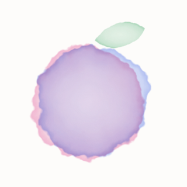
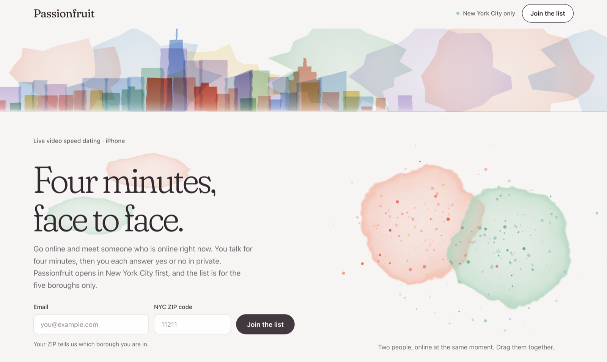
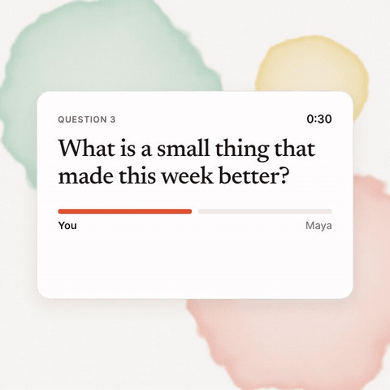
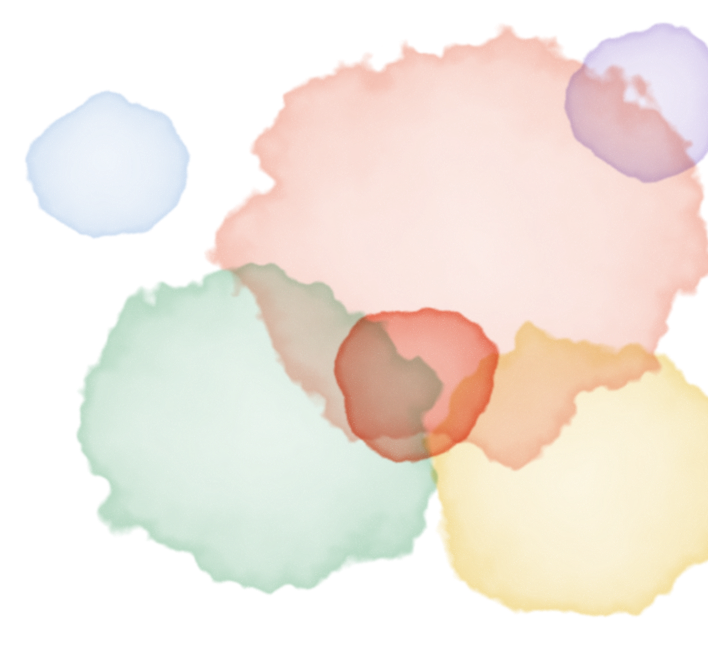
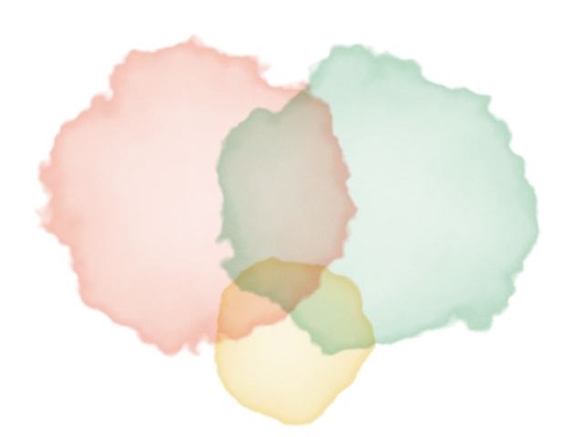

<p align="center">
  
</p>

<h1 align="center">Passionfruit</h1>

<p align="center">
  <b>Four minutes, face to face.</b><br>
  Live video speed dating for iPhone, opening in New York City first.
</p>

<p align="center">
  <a href="https://smammadov1994.github.io/Passionfruit-IOS/"><b>Join the waitlist</b></a>
  &nbsp;·&nbsp; <a href="#how-a-date-works">How a date works</a>
  &nbsp;·&nbsp; <a href="#run-it">Run it</a>
  &nbsp;·&nbsp; <a href="#what-is-in-this-repository">What is in here</a>
</p>

<p align="center">
  <a href="https://smammadov1994.github.io/Passionfruit-IOS/">
    
  </a>
</p>

## The idea

Most dating apps are an inbox. Passionfruit is a room.

You go online and you are paired with someone compatible who is online at the same moment. You
talk on video for four minutes. When the clock runs out you each answer yes or no in private.
Two yeses make a match and open a chat. Anything else, and you are both back in the queue without
anyone knowing who said what.

<p align="center">
  
  
  
  
  
  
  
  
  
  
</p>

## How a date works

<table>
  <tr>
    <td width="46%">
      
    </td>
    <td>
      <ol>
        <li><b>Go online.</b> One button. The server pairs you with someone whose filters you fit and who fits yours.</li>
        <li><b>Talk for four minutes.</b> Video goes directly between the two phones. Either of you can leave at any moment.</li>
        <li><b>Take turns, if you like.</b> An optional icebreaker card gives each of you 30 seconds on the same question, like a chess clock. Hide it whenever you want.</li>
        <li><b>Answer in private.</b> Yes or no, within 20 seconds. No answer counts as no.</li>
        <li><b>Match or move on.</b> Two yeses open a chat, with a button to call again. Otherwise you are back in the queue.</li>
      </ol>
    </td>
  </tr>
</table>

Five dates a day are free. Premium removes the limit and adds more filters.

## Built to be safe

- Adults only, checked at sign-up.
- Video frames from your own camera are sampled during a date and checked for nudity. A hit ends
  the call for both people straight away.
- Speech is transcribed on the phone and the text is checked for sexual language: a warning the
  first time, the call ends the second.
- Three strikes suspend an account until it is reviewed.
- Report and block are on every call and every match. Blocked pairs are never paired again.
- You can delete your account and its data from Settings.

<p align="center">
  
  &nbsp;&nbsp;&nbsp;
  
</p>

## What is in this repository

| Folder | What it is | Built with |
|---|---|---|
| [`ios/`](ios) | The iPhone app | SwiftUI, iOS 18+, WebRTC, StoreKit 2, XcodeGen |
| [`server/`](server) | The API: sign-in, matchmaking, date timing, chat, moderation, purchases | Node 22, TypeScript, Fastify, WebSocket, Postgres |
| [`site/`](site) | The launch page and New York City waitlist | Plain HTML, CSS and JavaScript, no build step |
| [`marketing/`](marketing) | Source for the watercolor motion clips | Remotion |
| [`preview/`](preview) | A single-file clickable preview of the app design | HTML |

The contract between the app and the server is [`SPEC.md`](SPEC.md). The look is described in
[`DESIGN-V2.md`](DESIGN-V2.md). The database is described in
[`server/DATA-MODEL.md`](server/DATA-MODEL.md).

The code still uses the working name "Tempo" for folders, targets and types. The product name
comes from one constant in each codebase: `ios/Tempo/App/Brand.swift` and
`server/src/appName.ts`.

```
iPhone app ──REST + WebSocket──▶ server ──▶ Postgres
     │                              ▲
     └────── video, peer to peer ───┘ (signalling only; video never passes through the server)

launch page ──▶ two database functions ──▶ waitlist table
```

## Run it

### The app, with no backend

```bash
brew install xcodegen
```

```bash
cd ios && xcodegen && open Tempo.xcodeproj
```

Pick the **Tempo** scheme and an iPhone simulator, press Run, then tap **Try the demo**. A
scripted partner shows up a few seconds after you go online. Nothing leaves the device.
[`ios/README.md`](ios/README.md) covers live mode and running on a real phone.

### The server

```bash
cd server && npm install && cp .env.example .env
```

Set `JWT_SECRET` in `.env` to at least 32 characters, then:

```bash
npm run dev
```

```bash
npm test
```

Without `DATABASE_URL` the server keeps everything in memory, which is enough to try it.
[`server/README.md`](server/README.md) covers Postgres, Supabase and deployment.

### The launch page

```bash
node site/serve.mjs
```

Then open http://localhost:4174. Run this way, sign-ups are written to a local file, or to the
`waitlist` table if `DATABASE_URL` is set.

## The launch page and waitlist

Live at **https://smammadov1994.github.io/Passionfruit-IOS/**. Every push to `main` that touches
`site/` publishes it again through [`.github/workflows/pages.yml`](.github/workflows/pages.yml).

- The skyline is drawn on a canvas, one watercolor building at a time, and each building sits on
  its own spring. Scrolling sends a wave through it.
- The two washes in the hero can be dragged together. They are surrounded by particles that
  scatter when the washes meet.
- Further down, a pinned stage plays through one date as you scroll, with the clock counting
  down from 4:00.
- The waitlist only accepts ZIP codes in the five boroughs. The form tells you your borough as
  you type and, once you join, your place in line for that borough and for the city.

GitHub Pages only serves files, so the hosted form talks to the database directly. It can call
exactly two functions, `waitlist_join` and `waitlist_stats`
([`server/migrations/005_waitlist_public.sql`](server/migrations/005_waitlist_public.sql)). They
check the email and ZIP again, limit how fast one address can try, and return counts only. The
table itself cannot be read or written from outside. To switch the hosted form on, put the
Supabase project's public key in [`site/config.js`](site/config.js).

## Status

Pre-launch. The app and server are complete enough to run a date end to end between two phones.
The waitlist is open for New York City.
