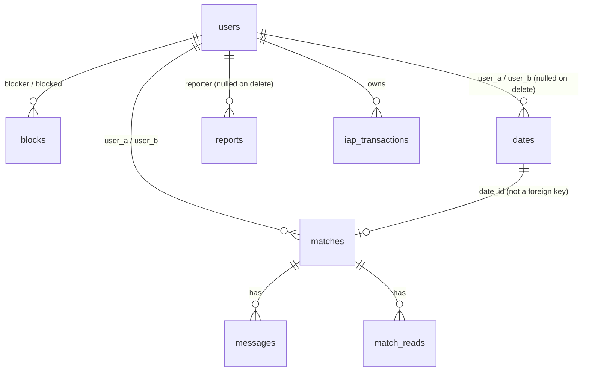

# Tempo data model

What is stored, where, and why. The schema is plain Postgres (`migrations/*.sql`), so it runs
unchanged on Supabase. `SPEC.md` section 3 remains the source of truth for the wire protocol; this
file covers storage only.

## Where things live

| Data | Where | Notes |
|---|---|---|
| Accounts, profiles, preferences | Postgres `users` | one row per person |
| Pairings and their outcome | Postgres `dates` | includes each side's private yes/no |
| Matches, chat | Postgres `matches`, `messages`, `match_reads` | |
| Safety | Postgres `blocks`, `reports`, `audit_log`, `deleted_identities` | |
| Purchases | Postgres `iap_transactions` | which Apple transaction belongs to whom |
| Who is online, the queue, live dates and calls | server memory | lost on restart by design; see README "Scaling beyond one instance" |
| Photos | blob store (local disk or S3-compatible) | `users.photo_urls` holds the URLs |
| Video and audio | nowhere | peer to peer; never stored |
| Agent briefs, characters | the phone | computed on device; nothing stored (see "Not modelled yet") |

## Tables

### `users`
Identity (`apple_sub`, unique), profile (`first_name`, `birthdate` as `YYYY-MM-DD` text, `gender`,
`interested_in`, `bio`, `city`, `lat`/`lng`, `photo_urls`), the six optional facts used by
dealbreakers and ranking (`intention`, `children`, `religion`, `education`, `smoking`, `drinking`),
`preferences` (jsonb: age range, distance, premium filters), Premium (`is_premium`,
`premium_expires_at`), moderation (`strikes`, `suspended`, `suspended_until`), push (`apns_token`,
`push_enabled`, `tz_offset_minutes`, `last_online_push_at`), `onboarding_complete`, `created_at`.

Enum-like columns are free `text`; the allowed values are enforced by the server (`src/types.ts`),
not by the database. Age is never stored: it is computed from `birthdate`.

### `dates`
One row per pairing: `user_a`, `user_b`, `created_at`, `started_at`, `ended_at`, `end_reason`,
`outcome` (`match` / `no_match`), and `decision_a` / `decision_b` (`yes` / `no`; NULL when the date
ended before the yes/no screen; no answer by the deadline is stored as `no`).

Used for: the 24-hour re-pair cooldown, the free daily cap (rows with `started_at` today), and the
ranking score (each person's yes/no history, `matchmaking/score.ts`). Decisions are never sent to
clients.

### `matches`, `messages`, `match_reads`
`matches`: one row per pair, `user_a < user_b` enforced so a pair can only match once; `date_id`
points at the date that produced it. `messages`: `seq` gives a strict order; `client_id` makes
sends idempotent per `(match, sender)`. `match_reads`: last time each person read each match;
unread counts are derived from it.

### Safety: `blocks`, `reports`, `audit_log`, `deleted_identities`
`blocks` is directional. `reports.reported_user_id` is deliberately not a foreign key, so a report
outlives the account it is about. `audit_log` is append-only and never holds frames or transcript
text. `deleted_identities` carries strikes across delete-and-recreate, keyed by a salted hash of
the Apple identity; it holds no profile data.

### `iap_transactions`
Binds an Apple `original_transaction_id` to one user, so a receipt cannot be reused by a second
account.

## What happens when an account is deleted

| Table | Effect |
|---|---|
| `users` | row deleted |
| `matches` (and their `messages`, `match_reads`) | deleted (cascade) |
| `blocks`, `iap_transactions` | deleted (cascade) |
| `dates` | row kept, that participant set to NULL (the other person's daily count stays right) |
| `reports` | kept; `reporter_id` set to NULL if the deleted person was the reporter |
| `audit_log` | kept |
| `deleted_identities` | a row is written if the account had strikes or a suspension |

## Running on Supabase

0. Quickest: `npm run db:use-supabase` asks for the connection string, writes `.env` and applies the
   migrations (it restores `.env` if they fail). If it reports a certificate error, download the
   project's certificate (Database settings > SSL configuration) and set `DATABASE_SSL_CA_PATH`.
1. Use Supabase as the Postgres host only. Set `DATABASE_URL` to the project's connection string
   (the session pooler one works with the server's connection pool) and `DATABASE_SSL=1`.
   Migrations apply at server start, or with `npm run migrate`.
2. Row level security is enabled on every table with no policies (`003_row_level_security.sql`).
   The Tempo server connects as the owner and is unaffected; the public Data API can read and
   write nothing. Do not add policies unless a client is meant to query Supabase directly.
3. Supabase Auth is not used. Sign in with Apple is verified by the Tempo server, which issues its
   own session tokens. `users.id` is Tempo's id, not `auth.users.id`.
4. Photos can go to Supabase Storage through its S3-compatible endpoint (`BLOB_STORE=s3` and the
   `S3_*` variables); nothing in the schema changes.
5. Supabase Realtime is not used. Live traffic goes over the Tempo server's own WebSocket.

## Not modelled yet

These exist in the app or are planned, and have no tables. Each is a decision before it is a
migration.

| Need | Sketch | Open question |
|---|---|---|
| Agent item state (added to calendar, dismissed) | `agent_item_states(user_id, match_id, item_key, state, created_at)`, PK on the first three | Today this lives in app memory and resets on relaunch. Worth syncing across devices? |
| Agent briefs from a language model | `agent_briefs(match_id, user_id, standing, status, items jsonb, model, created_at)`, one current row per (match, user) | Sending conversations to a model needs consent copy and a retention rule first |
| List of people I blocked | no new table: `blocks` already has it; needs a `GET /v1/blocks` endpoint | |
| Sign in with Apple token revocation | `users.apple_refresh_token` (encrypted) | Required by the App Store for account deletion |
| Queue and presence across instances | Redis, not Postgres | See README |
| Fitted ranking weights | `ranking_weights(version, weights jsonb, trained_at)` | Only once there are enough rows in `dates` to fit on |
